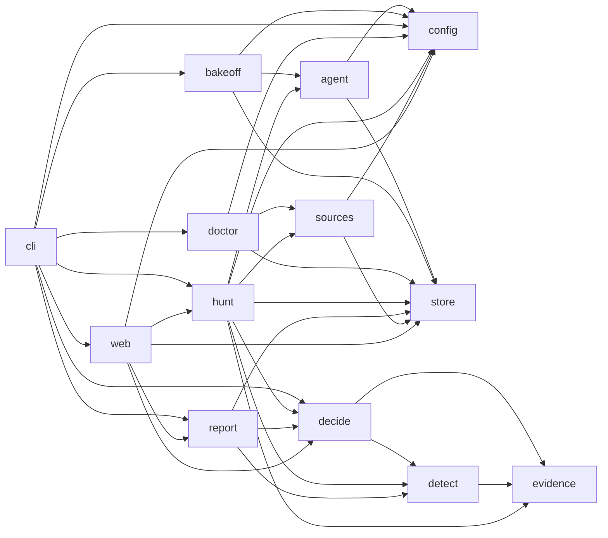

# Module map (generated)

Generated by `python scripts/archmap.py`. Do not edit by hand.

## Modules

| Module | Purpose (first docstring line) | Imports (internal) |
|---|---|---|
| `romulus` | ROMULUS: defensive AI-assisted threat hunting. |  |
| `romulus.agent` | Model investigator: case queue, briefs, structured model decisions, validation and typed pivots. | `romulus.agent.controller` |
| `romulus.agent.brief` | Compact, deterministic briefs rebuilt from durable investigator state. | `romulus.agent.models`, `romulus.agent.ollama`, `romulus.store.repo` |
| `romulus.agent.cases` | Deterministic seed clustering for bounded, breadth-first investigations. | `romulus.agent.models` |
| `romulus.agent.controller` | Explicit, bounded, resumable model-investigation controller. | `romulus.agent.brief`, `romulus.agent.cases`, `romulus.agent.models`, `romulus.agent.ollama`, `romulus.agent.tools`, `romulus.agent.validate`, `romulus.config`, `romulus.store.db`, `romulus.store.repo` |
| `romulus.agent.models` | Source-independent types exchanged by the investigator controller. |  |
| `romulus.agent.ollama` | Ollama chat client with JSON-schema structured output, explicit num_ctx and truncation checks. | `romulus.config` |
| `romulus.agent.tools` | Strict source-neutral argument schemas for the M1 investigator tools. | `romulus.agent.models` |
| `romulus.agent.validate` | Semantic validation for one untrusted investigator proposal. | `romulus.agent.brief`, `romulus.agent.models`, `romulus.agent.tools` |
| `romulus.bakeoff` | Model bakeoff (spec §12): frozen investigator briefs replayed against candidate models. |  |
| `romulus.bakeoff.export` | Rebuild the investigator's historical briefs as frozen bakeoff tasks. | `romulus.agent.brief`, `romulus.agent.cases`, `romulus.agent.models`, `romulus.agent.tools`, `romulus.store.db`, `romulus.store.repo` |
| `romulus.bakeoff.runner` | Run frozen bakeoff tasks against candidate models through the production model path. | `romulus.agent.brief`, `romulus.agent.controller`, `romulus.agent.models`, `romulus.agent.ollama`, `romulus.agent.validate`, `romulus.bakeoff.export`, `romulus.config` |
| `romulus.cli` | Command-line entry point (`romulus ...`). Thin: parses arguments and calls services. | `romulus.bakeoff.export`, `romulus.bakeoff.runner`, `romulus.config`, `romulus.decide.policy`, `romulus.doctor`, `romulus.hunt.run`, `romulus.report.manifest`, `romulus.report.markdown`, `romulus.web.app`, `romulus.web.auth` |
| `romulus.config` | Load runtime configuration from the environment / .env with secret redaction. |  |
| `romulus.decide` | Finding admission gates, escalation lanes, explained priority, triage and suppressions. |  |
| `romulus.decide.policy` | Canonical FindingDecision policy shared by every interface (spec section 10). | `romulus.detect.base`, `romulus.evidence.typed` |
| `romulus.detect` | Hunt playbooks, typed evaluators and the per-rule coverage ledger. |  |
| `romulus.detect.base` | Playbook contract: required typed fields, claim wording, evaluation, coverage semantics. | `romulus.evidence.typed` |
| `romulus.detect.correlation` | Host↔network playbooks: process sockets from auditd, and their joins to network-sensor records. | `romulus.detect.base`, `romulus.detect.host`, `romulus.evidence.shellparse`, `romulus.evidence.typed` |
| `romulus.detect.host` | Host playbooks over typed process_exec / auth events (Linux, lab telemetry). | `romulus.detect.base`, `romulus.evidence.shellparse`, `romulus.evidence.typed` |
| `romulus.detect.network` | Network and web-access playbooks (Suricata EVE, Apache access). Aggregates are exact counts | `romulus.detect.base`, `romulus.evidence.typed` |
| `romulus.detect.registry` | The active playbook pack and per-source applicability. | `romulus.detect.correlation`, `romulus.detect.host`, `romulus.detect.network`, `romulus.detect.sessions` |
| `romulus.detect.sessions` | Network-session playbooks over Arkime SPI records (net_session). | `romulus.detect.base`, `romulus.detect.correlation`, `romulus.evidence.typed` |
| `romulus.doctor` | Read-only environment checks: sources, least privilege, model endpoint, tools, storage. | `romulus.config`, `romulus.sources.es`, `romulus.store.db` |
| `romulus.evidence` | Raw references, typed normalization with field lineage, and entities. |  |
| `romulus.evidence.auditd` | Parse Linux audit records (raw `type=... msg=audit(ts:serial): k=v ...` lines) exactly. |  |
| `romulus.evidence.normalize` | Per-event-family normalizers for the lab schema. Dispatch on authoritative type fields only. | `romulus.evidence.auditd`, `romulus.evidence.typed` |
| `romulus.evidence.shellparse` | Token-aware parsing of shell command strings into pipelines, commands and redirections. |  |
| `romulus.evidence.typed` | Typed events with field-level lineage. Unknown stays unknown; nothing is inferred from free text. |  |
| `romulus.hunt` | Hunt orchestration: immutable manifest, partition planning, the sweep and coverage accounting. |  |
| `romulus.hunt.manifest` | Build the immutable hunt manifest (scope, sources, versions, budgets, config digest). | `romulus`, `romulus.config`, `romulus.decide.policy`, `romulus.detect.registry`, `romulus.evidence.normalize`, `romulus.sources.models`, `romulus.store.db` |
| `romulus.hunt.pivot` | Hunt-layer execution of validated, source-neutral investigator pivots. | `romulus.agent.models`, `romulus.agent.tools`, `romulus.detect.registry`, `romulus.evidence.normalize`, `romulus.evidence.typed`, `romulus.hunt.publish`, `romulus.sources.es`, `romulus.sources.execute`, `romulus.sources.models`, `romulus.sources.profile`, `romulus.store.db`, `romulus.store.repo` |
| `romulus.hunt.publish` | Shared deterministic publication for sweep and investigator discoveries. | `romulus.decide.policy`, `romulus.detect.base`, `romulus.store.repo` |
| `romulus.hunt.run` | Create and run a hunt end to end: inventory -> sweep -> agent investigation -> result. | `romulus.agent.controller`, `romulus.config`, `romulus.hunt.manifest`, `romulus.hunt.pivot`, `romulus.hunt.sweep`, `romulus.sources.es`, `romulus.sources.models`, `romulus.sources.profile`, `romulus.store.db`, `romulus.store.repo` |
| `romulus.hunt.stage` | Per-hunt disk staging for aggregate playbooks that join large event sets. | `romulus.evidence.typed` |
| `romulus.hunt.sweep` | The deterministic sweep: plan partitions, stream every partition through normalization and all | `romulus.detect.base`, `romulus.detect.registry`, `romulus.evidence.normalize`, `romulus.hunt.publish`, `romulus.hunt.stage`, `romulus.sources.es`, `romulus.sources.execute`, `romulus.sources.models`, `romulus.sources.profile`, `romulus.store.db`, `romulus.store.repo` |
| `romulus.report` | Canonical report manifest and renderers (JSON, technical Markdown); renderers never re-evaluate. |  |
| `romulus.report.manifest` | Build one immutable, versioned ReportManifest from a consistent DB snapshot (spec section 13). | `romulus.decide.policy`, `romulus.detect.registry`, `romulus.store`, `romulus.store.db`, `romulus.store.repo` |
| `romulus.report.markdown` | Technical Markdown report rendered strictly from a ReportManifest. |  |
| `romulus.sources` | Source profiles, field contracts, typed query compilation and read-only adapters. |  |
| `romulus.sources.compile` | Compile typed SearchIntents into validated backend queries through the FieldContract. | `romulus.sources.models`, `romulus.sources.profile`, `romulus.store.db` |
| `romulus.sources.es` | Read-only Elasticsearch/OpenSearch adapter with an HTTP allowlist that blocks write APIs. | `romulus.config`, `romulus.sources.models` |
| `romulus.sources.execute` | Execute compiled intents against a source and produce complete-or-explicitly-partial outcomes. | `romulus.sources.compile`, `romulus.sources.es`, `romulus.sources.models`, `romulus.sources.profile` |
| `romulus.sources.models` | Typed search intents, compiled queries and search outcomes shared by all adapters. |  |
| `romulus.sources.profile` | Build SourceProfiles and FieldContracts from the live mapping of a concrete target. | `romulus.store.db` |
| `romulus.store` | Single SQLite state authority: schema, engine and repositories. |  |
| `romulus.store.db` | Engine creation (SQLite WAL), migrations, integrity check and small helpers. | `romulus.store.schema` |
| `romulus.store.migrations.env` | Alembic environment: runs against the connection supplied by romulus.store.db.migrate. | `romulus.store.schema` |
| `romulus.store.migrations.versions.0001_initial_m1_schema` | initial m1 schema |  |
| `romulus.store.migrations.versions.0002_hunt_lease` | add durable investigator lease and idempotent case steps |  |
| `romulus.store.migrations.versions.0003_hunt_lease_owner` | add hunt lease owner fencing token |  |
| `romulus.store.repo` | Idempotent repository operations over the single SQLite authority. | `romulus.store`, `romulus.store.db` |
| `romulus.store.schema` | SQLAlchemy Core table definitions for the M1 slice (versioned via Alembic). |  |
| `romulus.web` | Browser UI: FastAPI + server-rendered Jinja2 templates, local auth, no external assets. |  |
| `romulus.web.app` | FastAPI application. Thin: reads the store, calls services, renders escaped templates. | `romulus.config`, `romulus.decide.policy`, `romulus.hunt.run`, `romulus.report.manifest`, `romulus.report.markdown`, `romulus.store`, `romulus.web.auth` |
| `romulus.web.auth` | Local accounts (argon2), signed session cookies, CSRF tokens and login rate limiting. | `romulus.store`, `romulus.store.db` |

## Package dependencies

