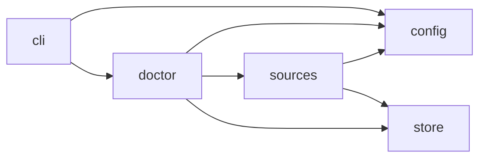

# Module map (generated)

Generated by `python scripts/archmap.py`. Do not edit by hand.

## Modules

| Module | Purpose (first docstring line) | Imports (internal) |
|---|---|---|
| `romulus` | ROMULUS: defensive AI-assisted threat hunting. |  |
| `romulus.cli` | Command-line entry point (`romulus ...`). Thin: parses arguments and calls services. | `romulus.config`, `romulus.doctor` |
| `romulus.config` | Load runtime configuration from the environment / .env with secret redaction. |  |
| `romulus.doctor` | Read-only environment checks: sources, least privilege, model endpoint, tools, storage. | `romulus.config`, `romulus.sources.es`, `romulus.store.db` |
| `romulus.sources` | Source profiles, field contracts, typed query compilation and read-only adapters. |  |
| `romulus.sources.compile` | Compile typed SearchIntents into validated backend queries through the FieldContract. | `romulus.sources.models`, `romulus.sources.profile`, `romulus.store.db` |
| `romulus.sources.es` | Read-only Elasticsearch/OpenSearch adapter with an HTTP allowlist that blocks write APIs. | `romulus.config`, `romulus.sources.models` |
| `romulus.sources.execute` | Execute compiled intents against a source and produce complete-or-explicitly-partial outcomes. | `romulus.sources.compile`, `romulus.sources.es`, `romulus.sources.models`, `romulus.sources.profile` |
| `romulus.sources.models` | Typed search intents, compiled queries and search outcomes shared by all adapters. |  |
| `romulus.sources.profile` | Build SourceProfiles and FieldContracts from the live mapping of a concrete target. | `romulus.store.db` |
| `romulus.store` | Single SQLite state authority: schema, engine and repositories. |  |
| `romulus.store.db` | Engine creation (SQLite WAL), migrations, integrity check and small helpers. | `romulus.store.schema` |
| `romulus.store.migrations.env` | Alembic environment: runs against the connection supplied by romulus.store.db.migrate. | `romulus.store.schema` |
| `romulus.store.migrations.versions.0001_initial_m1_schema` | initial m1 schema |  |
| `romulus.store.schema` | SQLAlchemy Core table definitions for the M1 slice (versioned via Alembic). |  |

## Package dependencies

