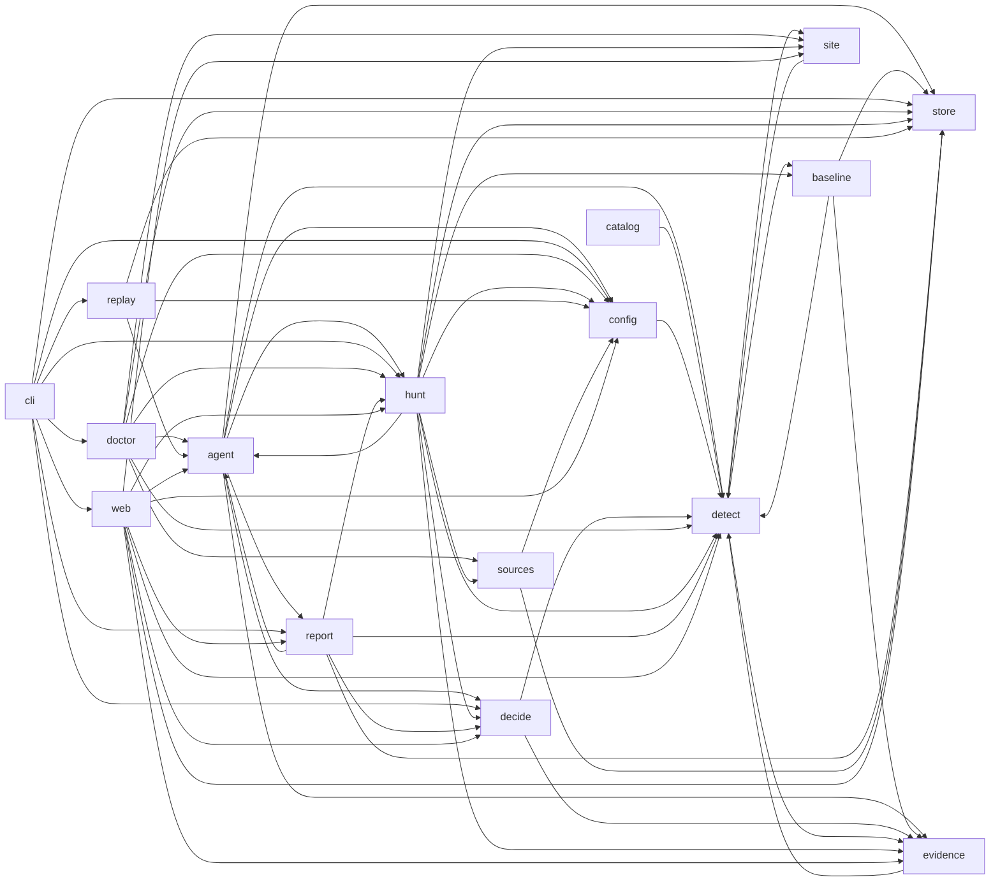

# Module map (generated)

Generated by `python scripts/archmap.py`. Do not edit by hand.

## Modules

| Module | Purpose (first docstring line) | Imports (internal) |
|---|---|---|
| `romulus` | ROMULUS: defensive AI-assisted threat hunting. |  |
| `romulus.agent` | Model investigator: case queue, briefs, structured model decisions, validation and typed pivots. | `romulus.agent.controller` |
| `romulus.agent.aliases` | Durable, deterministic short aliases for model-visible hunt objects. | `romulus.store.repo` |
| `romulus.agent.brief` | Compact, deterministic briefs rebuilt from durable investigator state. | `romulus.agent.cases`, `romulus.agent.constraints`, `romulus.agent.models`, `romulus.agent.ollama`, `romulus.agent.options`, `romulus.store.repo` |
| `romulus.agent.cases` | Deterministic seed clustering for bounded, breadth-first investigations. | `romulus.agent.models` |
| `romulus.agent.constraints` | Per-call JSON schemas for investigator menu selections. | `romulus.agent.options` |
| `romulus.agent.controller` | Explicit, bounded, resumable model-investigation controller. | `romulus.agent.brief`, `romulus.agent.cases`, `romulus.agent.constraints`, `romulus.agent.models`, `romulus.agent.ollama`, `romulus.agent.resolver`, `romulus.agent.tools`, `romulus.agent.validate`, `romulus.config`, `romulus.store.db`, `romulus.store.repo` |
| `romulus.agent.dossier` | Deterministic, paged JSON dossier assembled only from persisted hunt state. | `romulus.agent.aliases`, `romulus.agent.provider.base`, `romulus.agent.provider.budget`, `romulus.agent.safety`, `romulus.decide.policy`, `romulus.hunt.expansion_plan`, `romulus.report.incidents`, `romulus.report.manifest`, `romulus.store.db`, `romulus.store.repo` |
| `romulus.agent.models` | Source-independent types exchanged by the investigator controller. |  |
| `romulus.agent.ollama` | Ollama chat client with JSON-schema structured output, explicit num_ctx and truncation checks. | `romulus.config` |
| `romulus.agent.options` | Pure, deterministic menus for investigator-v2 decisions. | `romulus.agent.cases`, `romulus.agent.models` |
| `romulus.agent.provider` | Model-provider port for the AI investigating agent: readiness, the adapter factory and call recording. | `romulus.agent.provider.base`, `romulus.agent.provider.budget`, `romulus.agent.provider.egress`, `romulus.agent.provider.ollama`, `romulus.agent.provider.openai_compatible`, `romulus.config`, `romulus.store.db` |
| `romulus.agent.provider.base` | The model-provider port: one chat interface for every adapter, with truncation, usage and finish-reason checks. | `romulus.agent.provider.egress`, `romulus.config` |
| `romulus.agent.provider.budget` | Per-hunt agent budgets: calls, tokens, wall-clock time and an optional estimated cost. | `romulus.agent.provider.base`, `romulus.config` |
| `romulus.agent.provider.egress` | Classify a model endpoint as local or remote, and decide whether telemetry excerpts may be sent to it. |  |
| `romulus.agent.provider.ollama` | Adapter for Ollama's native chat API, for small local runs. | `romulus.agent.provider.base`, `romulus.agent.provider.openai_compatible`, `romulus.config` |
| `romulus.agent.provider.openai_compatible` | Adapter for any server that speaks the OpenAI Chat Completions API with tool calling and JSON-schema output. | `romulus.agent.provider.base`, `romulus.config` |
| `romulus.agent.resolver` | Resolve one constrained menu selection to an existing typed decision. | `romulus.agent.brief`, `romulus.agent.constraints`, `romulus.agent.models`, `romulus.agent.validate` |
| `romulus.agent.safety` | Flag instruction-shaped untrusted data without interpreting or executing it. |  |
| `romulus.agent.toolbox` | Strict model-facing read tools over persisted hunt state. | `romulus.agent`, `romulus.agent.aliases`, `romulus.agent.dossier`, `romulus.agent.models`, `romulus.agent.provider.base`, `romulus.agent.safety`, `romulus.decide.policy`, `romulus.detect.registry`, `romulus.evidence.typed`, `romulus.report.incidents`, `romulus.report.manifest`, `romulus.store.db`, `romulus.store.repo` |
| `romulus.agent.tools` | Strict source-neutral argument schemas for the investigator tools. | `romulus.agent.models` |
| `romulus.agent.validate` | Semantic validation for one untrusted investigator proposal. | `romulus.agent.brief`, `romulus.agent.models`, `romulus.agent.tools` |
| `romulus.baseline` | Pure baseline specifications and typed key extraction. | `romulus.baseline.carry`, `romulus.baseline.count`, `romulus.baseline.protocol`, `romulus.baseline.spec` |
| `romulus.baseline.carry` | Disk-backed process-parent carry-in and explicit Pending resolution. | `romulus.baseline.spec`, `romulus.detect.correlation`, `romulus.detect.observed`, `romulus.evidence.typed`, `romulus.store.repo` |
| `romulus.baseline.count` | Pure, bounded counting of typed baseline keys into immutable segment rows. | `romulus.baseline.reasons`, `romulus.baseline.spec`, `romulus.evidence.typed` |
| `romulus.baseline.lookback` | Exact, budgeted construction of immutable baseline history segments. | `romulus.baseline.carry`, `romulus.baseline.count`, `romulus.baseline.playbook`, `romulus.baseline.protocol`, `romulus.baseline.spec`, `romulus.evidence.typed`, `romulus.store.db`, `romulus.store.repo` |
| `romulus.baseline.playbook` | Sweep-facing baseline playbooks and their cell-scoped accumulation contract. | `romulus.baseline.carry`, `romulus.baseline.count`, `romulus.baseline.spec`, `romulus.detect.base`, `romulus.evidence.typed` |
| `romulus.baseline.protocol` | Source-neutral contracts for exact baseline history retrieval. | `romulus.evidence.typed` |
| `romulus.baseline.rate` | Deterministic statistics for hourly baseline-rate series. |  |
| `romulus.baseline.reasons` | Bounded coverage reasons: classes with exact counts and a few example record ids, never one entry per record. |  |
| `romulus.baseline.snapshot` | Deterministic planning of a hunt's immutable baseline history cut. | `romulus.baseline.lookback`, `romulus.baseline.spec`, `romulus.store.repo` |
| `romulus.baseline.spec` | Pure baseline specifications, canonical keys, and unresolved process-parent carry-in. | `romulus.detect`, `romulus.detect.correlation`, `romulus.detect.dns`, `romulus.evidence.typed` |
| `romulus.catalog` | Reusable public ATT&CK and ROMULUS detection catalog. | `romulus.catalog.attack`, `romulus.catalog.build`, `romulus.catalog.export`, `romulus.catalog.models` |
| `romulus.catalog.attack` | Bounded loader for the pinned ATT&CK Enterprise STIX bundle. | `romulus.catalog.models` |
| `romulus.catalog.build` | Build public detection coverage from typed playbook metadata. | `romulus.catalog.attack`, `romulus.catalog.models`, `romulus.detect.indicators`, `romulus.detect.registry` |
| `romulus.catalog.export` | Stable JSON-ready export of the public detection catalog. | `romulus.catalog.build`, `romulus.catalog.models` |
| `romulus.catalog.models` | Typed, deterministic public catalog records. |  |
| `romulus.catalog.render` | Human-readable rendering for the public ATT&CK coverage catalog. | `romulus.catalog.build`, `romulus.catalog.models` |
| `romulus.cli` | Command-line entry point (`romulus ...`). Thin: parses arguments and calls services. | `romulus.config`, `romulus.decide.policy`, `romulus.doctor`, `romulus.hunt.run`, `romulus.replay.export`, `romulus.replay.runner`, `romulus.report.manifest`, `romulus.report.markdown`, `romulus.store.db`, `romulus.web.app`, `romulus.web.auth` |
| `romulus.config` | Load runtime configuration from the environment / .env with secret redaction. | `romulus.detect.netdef` |
| `romulus.decide` | Finding admission gates, escalation lanes, explained priority, triage and suppressions. |  |
| `romulus.decide.policy` | Canonical FindingDecision policy shared by every interface (spec section 10). | `romulus.detect.base`, `romulus.evidence.typed` |
| `romulus.detect` | Hunt playbooks, typed evaluators and the per-rule coverage ledger. |  |
| `romulus.detect.auth` | SSH password guessing, spraying and success after failures; account and group creation or modification. | `romulus.detect.base`, `romulus.detect.bounded`, `romulus.detect.citing`, `romulus.detect.host`, `romulus.detect.linux_argv`, `romulus.evidence.shellparse`, `romulus.evidence.typed` |
| `romulus.detect.base` | Playbook contract: required typed fields, claim wording, evaluation, coverage semantics. | `romulus.detect.bounded`, `romulus.evidence.typed` |
| `romulus.detect.bounded` | Bounded detector state. |  |
| `romulus.detect.citing` | What an aggregate claim cites, and how it says so. | `romulus.evidence.typed` |
| `romulus.detect.context` | Anchor-gated context rules. They never run in the full-window sweep. | `romulus.detect.base`, `romulus.detect.correlation`, `romulus.detect.host`, `romulus.detect.linux_argv`, `romulus.evidence.shellparse`, `romulus.evidence.typed` |
| `romulus.detect.correlation` | Host↔network playbooks: process sockets from auditd, and their joins to network-sensor records. | `romulus.detect`, `romulus.detect.base`, `romulus.detect.bounded`, `romulus.detect.citing`, `romulus.detect.host`, `romulus.detect.observed`, `romulus.evidence.shellparse`, `romulus.evidence.typed` |
| `romulus.detect.dns` | DNS reconnaissance and DNS channel-shape aggregates over typed `dns_query` records. | `romulus.detect.base`, `romulus.detect.bounded`, `romulus.detect.citing`, `romulus.detect.host`, `romulus.evidence.typed` |
| `romulus.detect.flows` | Flow-shape playbooks over bidirectional connection records (Suricata flow records, Arkime sessions). | `romulus.detect.base`, `romulus.detect.bounded`, `romulus.detect.citing`, `romulus.detect.correlation`, `romulus.detect.netdef`, `romulus.evidence.typed` |
| `romulus.detect.hijack` | A non-root account runs a write-capable command on a file that a root process executes. | `romulus.detect.base`, `romulus.detect.bounded`, `romulus.detect.correlation`, `romulus.detect.host`, `romulus.detect.linux_argv`, `romulus.evidence.shellparse`, `romulus.evidence.typed` |
| `romulus.detect.host` | Host playbooks over typed process_exec / auth events (Linux, lab telemetry). | `romulus.detect`, `romulus.detect.base`, `romulus.detect.bounded`, `romulus.detect.citing`, `romulus.detect.indicators`, `romulus.detect.linux_argv`, `romulus.detect.observed`, `romulus.evidence.shellparse`, `romulus.evidence.typed` |
| `romulus.detect.indicators` | Indicator lists matched by field role. | `romulus.detect.base`, `romulus.detect.bounded`, `romulus.detect.citing`, `romulus.detect.host`, `romulus.evidence.shellparse`, `romulus.evidence.typed` |
| `romulus.detect.kernel_files` | Rules over kernel file records: exec-file ownership and file-change (PATH) records from Linux audit. | `romulus.detect.base`, `romulus.detect.bounded`, `romulus.detect.citing`, `romulus.detect.correlation`, `romulus.detect.hijack`, `romulus.detect.host`, `romulus.evidence.typed` |
| `romulus.detect.lineage` | Reverse shell by lineage: a shell or interpreter executed by a process that holds an external | `romulus.detect.base`, `romulus.detect.bounded`, `romulus.detect.citing`, `romulus.detect.correlation`, `romulus.detect.host`, `romulus.evidence.shellparse`, `romulus.evidence.typed` |
| `romulus.detect.linux_argv` | Token-aware helpers for Linux context rules: program identity from the kernel-recorded executable, file | `romulus.detect.base`, `romulus.evidence.shellparse`, `romulus.evidence.typed` |
| `romulus.detect.netdef` | The site's internal-network definition: which addresses belong to the site and which are outside it. | `romulus.site` |
| `romulus.detect.network` | Network and web-access playbooks (Suricata EVE, Apache access). Aggregates are exact counts | `romulus.detect.base`, `romulus.detect.bounded`, `romulus.detect.citing`, `romulus.detect.correlation`, `romulus.detect.dns`, `romulus.detect.flows`, `romulus.evidence.typed` |
| `romulus.detect.observed` | Process states seen in a process's own audit SYSCALL records, for lineage. | `romulus.evidence.typed` |
| `romulus.detect.packets` | Packet-content rules over content reconstructed by TShark from specific Arkime sessions. | `romulus.detect.base`, `romulus.detect.correlation`, `romulus.detect.host`, `romulus.evidence.typed` |
| `romulus.detect.registry` | The active playbook pack and per-source applicability. | `romulus.baseline.playbook`, `romulus.detect.auth`, `romulus.detect.base`, `romulus.detect.context`, `romulus.detect.correlation`, `romulus.detect.dns`, `romulus.detect.flows`, `romulus.detect.hijack`, `romulus.detect.host`, `romulus.detect.indicators`, `romulus.detect.kernel_files`, `romulus.detect.lineage`, `romulus.detect.network`, `romulus.detect.packets`, `romulus.detect.sessions`, `romulus.detect.tamper`, `romulus.detect.tls`, `romulus.detect.windows_common`, `romulus.detect.windows_credentials`, `romulus.detect.windows_defense`, `romulus.detect.windows_lineage`, `romulus.detect.windows_proxy`, `romulus.detect.windows_remote` |
| `romulus.detect.sessions` | Network-session playbooks over Arkime SPI records (net_session) and Suricata handshake records. | `romulus.detect.base`, `romulus.detect.bounded`, `romulus.detect.citing`, `romulus.detect.correlation`, `romulus.detect.netdef`, `romulus.evidence.typed` |
| `romulus.detect.tamper` | Audit and log tampering on Linux hosts. | `romulus.detect.base`, `romulus.detect.bounded`, `romulus.detect.citing`, `romulus.detect.host`, `romulus.detect.linux_argv`, `romulus.evidence.normalize`, `romulus.evidence.shellparse`, `romulus.evidence.typed` |
| `romulus.detect.tls` | Certificates that public servers presented to internal clients. | `romulus.detect.base`, `romulus.detect.bounded`, `romulus.detect.citing`, `romulus.detect.correlation`, `romulus.detect.netdef`, `romulus.evidence.typed` |
| `romulus.detect.windows_cmdline` | Windows command lines read as tokens, never as substrings. |  |
| `romulus.detect.windows_common` | Shared machinery for Windows process-creation rules. | `romulus.detect.base`, `romulus.detect.bounded`, `romulus.detect.citing`, `romulus.detect.host`, `romulus.detect.windows_cmdline`, `romulus.evidence.typed`, `romulus.evidence.windows_catalog` |
| `romulus.detect.windows_credentials` | Credential-store access recognised from command-line tokens (positive-only). | `romulus.detect.windows_cmdline`, `romulus.detect.windows_common`, `romulus.evidence.typed` |
| `romulus.detect.windows_defense` | Defense impairment and recovery inhibition recognised from command-line tokens (positive-only). | `romulus.detect.windows_cmdline`, `romulus.detect.windows_common`, `romulus.evidence.typed` |
| `romulus.detect.windows_lineage` | A document, mail, reader or browser application spawned a shell, script host or LOLBin. | `romulus.detect.windows_cmdline`, `romulus.detect.windows_common`, `romulus.evidence.typed` |
| `romulus.detect.windows_proxy` | Signed-binary proxy execution and LOLBin download or decode, recognised from command-line tokens. | `romulus.detect.base`, `romulus.detect.windows_cmdline`, `romulus.detect.windows_common`, `romulus.evidence.typed` |
| `romulus.detect.windows_remote` | Remote-execution traces on the target host. | `romulus.detect.windows_cmdline`, `romulus.detect.windows_common`, `romulus.evidence.typed` |
| `romulus.doctor` | Read-only environment checks: sources, least privilege, model endpoint, tools, storage. | `romulus.agent.provider`, `romulus.agent.provider.egress`, `romulus.config`, `romulus.detect.netdef`, `romulus.hunt.site_networks`, `romulus.hunt.sweep`, `romulus.site`, `romulus.sources.es`, `romulus.sources.profile`, `romulus.store.db` |
| `romulus.evidence` | Raw references, typed normalization with field lineage, and entities. |  |
| `romulus.evidence.auditd` | Parse Linux audit records (raw `type=... msg=audit(ts:serial): k=v ...` lines) exactly. |  |
| `romulus.evidence.community` | Shared Community ID v1 construction for host and network telemetry. |  |
| `romulus.evidence.normalize` | Per-event-family normalizers for the lab schema. Dispatch on authoritative type fields only. | `romulus.evidence.auditd`, `romulus.evidence.community`, `romulus.evidence.typed`, `romulus.evidence.windows` |
| `romulus.evidence.shellparse` | Token-aware parsing of shell command strings into pipelines, commands and redirections. |  |
| `romulus.evidence.typed` | Typed events with field-level lineage. Unknown stays unknown; nothing is inferred from free text. |  |
| `romulus.evidence.windows` | Windows shipper dispatch and structured-field extraction. | `romulus.detect.bounded`, `romulus.evidence.community`, `romulus.evidence.typed`, `romulus.evidence.windows_catalog` |
| `romulus.evidence.windows_catalog` | Authoritative Windows event classes keyed by channel, provider, and event id. |  |
| `romulus.evidence.windows_reassembly` | Bounded, disk-backed PowerShell script-block reassembly. | `romulus.detect.bounded`, `romulus.evidence.typed`, `romulus.evidence.windows` |
| `romulus.hunt` | Hunt orchestration: immutable manifest, partition planning, the sweep and coverage accounting. |  |
| `romulus.hunt.agent_tools` | Hunt-layer construction and execution boundary for model-facing pivot tools. | `romulus.agent.models`, `romulus.agent.toolbox`, `romulus.config`, `romulus.detect.registry`, `romulus.evidence.typed`, `romulus.hunt.expansion`, `romulus.hunt.links`, `romulus.hunt.pivot`, `romulus.hunt.publish`, `romulus.site`, `romulus.sources.models`, `romulus.store.db`, `romulus.store.repo` |
| `romulus.hunt.baseline_source` | Hunt-layer adapter from source retrieval to the baseline HistorySource protocol. | `romulus.baseline.protocol`, `romulus.evidence.normalize`, `romulus.hunt.sweep`, `romulus.sources.execute`, `romulus.sources.models`, `romulus.sources.profile` |
| `romulus.hunt.baseline_stage` | Run the frozen-history baseline stage and publish cited deviation leads. | `romulus.baseline.carry`, `romulus.baseline.count`, `romulus.baseline.lookback`, `romulus.baseline.playbook`, `romulus.baseline.rate`, `romulus.baseline.reasons`, `romulus.baseline.snapshot`, `romulus.baseline.spec`, `romulus.decide.policy`, `romulus.detect`, `romulus.detect.base`, `romulus.evidence.normalize`, `romulus.evidence.typed`, `romulus.hunt.baseline_source`, `romulus.hunt.baseline_writer`, `romulus.hunt.publish`, `romulus.hunt.site_networks`, `romulus.hunt.sweep`, `romulus.sources.models`, `romulus.store.repo` |
| `romulus.hunt.baseline_writer` | Publish a finished hunt's complete window hours as immutable baseline segments. | `romulus.baseline.carry`, `romulus.baseline.lookback`, `romulus.baseline.spec`, `romulus.detect`, `romulus.evidence.typed`, `romulus.hunt.site_networks`, `romulus.store.db`, `romulus.store.repo` |
| `romulus.hunt.context` | Context playbooks: per-link coverage, and one deterministic pass after expansion that aggregates every | `romulus.decide.policy`, `romulus.detect.base`, `romulus.detect.context`, `romulus.detect.correlation`, `romulus.detect.registry`, `romulus.evidence.typed`, `romulus.hunt.links`, `romulus.hunt.publish`, `romulus.hunt.sweep`, `romulus.store.db`, `romulus.store.repo` |
| `romulus.hunt.expansion` | Crash-safe deterministic post-sweep expansion over typed links. | `romulus.agent.models`, `romulus.decide.policy`, `romulus.detect`, `romulus.detect.correlation`, `romulus.detect.host`, `romulus.detect.netdef`, `romulus.detect.registry`, `romulus.evidence.typed`, `romulus.evidence.windows_catalog`, `romulus.hunt.context`, `romulus.hunt.expansion_plan`, `romulus.hunt.links`, `romulus.hunt.pivot`, `romulus.hunt.publish`, `romulus.hunt.sweep`, `romulus.sources.models`, `romulus.store.db`, `romulus.store.repo` |
| `romulus.hunt.expansion_plan` | Source-free deterministic expansion tier definitions. |  |
| `romulus.hunt.links` | Typed deterministic link fetchers for post-sweep expansion. | `romulus.agent.models`, `romulus.agent.tools`, `romulus.detect.correlation`, `romulus.detect.host`, `romulus.evidence.normalize`, `romulus.evidence.typed`, `romulus.evidence.windows_catalog`, `romulus.hunt.pivot`, `romulus.sources.models`, `romulus.store.db` |
| `romulus.hunt.manifest` | Build the immutable hunt manifest (scope, sources, versions, budgets, config digest). | `romulus`, `romulus.baseline.playbook`, `romulus.baseline.rate`, `romulus.config`, `romulus.decide.policy`, `romulus.detect.netdef`, `romulus.detect.registry`, `romulus.evidence.normalize`, `romulus.hunt.packets`, `romulus.site`, `romulus.sources.models`, `romulus.store.db` |
| `romulus.hunt.packets` | Packet stage: judge the content of selected HTTP sessions and cleartext TCP connections, after the sweep. | `romulus.config`, `romulus.detect.correlation`, `romulus.detect.packets`, `romulus.evidence.typed`, `romulus.hunt.publish`, `romulus.hunt.stage`, `romulus.sources.compile`, `romulus.sources.execute`, `romulus.sources.models`, `romulus.sources.packets`, `romulus.store.db` |
| `romulus.hunt.pivot` | Hunt-layer execution of validated, source-neutral investigator pivots. | `romulus.agent.models`, `romulus.agent.tools`, `romulus.detect.bounded`, `romulus.detect.host`, `romulus.detect.registry`, `romulus.evidence.auditd`, `romulus.evidence.normalize`, `romulus.evidence.typed`, `romulus.evidence.windows_catalog`, `romulus.evidence.windows_reassembly`, `romulus.hunt.publish`, `romulus.site`, `romulus.sources.es`, `romulus.sources.execute`, `romulus.sources.models`, `romulus.sources.profile`, `romulus.store.db`, `romulus.store.repo` |
| `romulus.hunt.publish` | Shared deterministic publication for sweep and investigator discoveries. | `romulus.decide.policy`, `romulus.detect.base`, `romulus.detect.observed`, `romulus.evidence.normalize`, `romulus.evidence.typed`, `romulus.store.repo` |
| `romulus.hunt.run` | Create and run a hunt end to end: inventory -> sweep -> agent investigation -> result. | `romulus.agent.controller`, `romulus.agent.provider`, `romulus.config`, `romulus.detect`, `romulus.evidence.normalize`, `romulus.hunt.baseline_stage`, `romulus.hunt.baseline_writer`, `romulus.hunt.expansion`, `romulus.hunt.links`, `romulus.hunt.manifest`, `romulus.hunt.packets`, `romulus.hunt.pivot`, `romulus.hunt.site_networks`, `romulus.hunt.stage`, `romulus.hunt.sweep`, `romulus.site`, `romulus.sources.es`, `romulus.sources.models`, `romulus.sources.profile`, `romulus.store.db`, `romulus.store.repo` |
| `romulus.hunt.site_networks` | The hunt's internal-network definition: installed from the hunt manifest, refused when the configuration | `romulus.config`, `romulus.detect`, `romulus.detect.correlation`, `romulus.detect.netdef`, `romulus.detect.registry`, `romulus.hunt.pivot`, `romulus.sources.models`, `romulus.sources.profile` |
| `romulus.hunt.stage` | Per-hunt disk staging for aggregate playbooks that join large event sets. | `romulus.baseline.spec`, `romulus.detect.bounded`, `romulus.detect.correlation`, `romulus.evidence.typed` |
| `romulus.hunt.sweep` | The deterministic sweep: plan partitions, stream every partition through normalization and all | `romulus.baseline.carry`, `romulus.baseline.playbook`, `romulus.baseline.reasons`, `romulus.baseline.spec`, `romulus.detect`, `romulus.detect.base`, `romulus.detect.bounded`, `romulus.detect.correlation`, `romulus.detect.host`, `romulus.detect.netdef`, `romulus.detect.observed`, `romulus.detect.registry`, `romulus.evidence.normalize`, `romulus.evidence.typed`, `romulus.evidence.windows`, `romulus.evidence.windows_catalog`, `romulus.evidence.windows_reassembly`, `romulus.hunt.publish`, `romulus.hunt.stage`, `romulus.site`, `romulus.sources.es`, `romulus.sources.execute`, `romulus.sources.models`, `romulus.sources.profile`, `romulus.store.db`, `romulus.store.repo` |
| `romulus.replay` | Investigator replay: frozen production briefs replayed through the model decision path. |  |
| `romulus.replay.export` | Rebuild the investigator's historical briefs as frozen replay tasks. | `romulus.agent.brief`, `romulus.agent.cases`, `romulus.agent.models`, `romulus.agent.tools`, `romulus.store.db`, `romulus.store.repo` |
| `romulus.replay.runner` | Run frozen replay tasks against candidate models through the production model path. | `romulus.agent.brief`, `romulus.agent.models`, `romulus.agent.ollama`, `romulus.agent.options`, `romulus.agent.resolver`, `romulus.agent.tools`, `romulus.config`, `romulus.replay.export` |
| `romulus.report` | Canonical report manifest and renderers (JSON, technical Markdown); renderers never re-evaluate. |  |
| `romulus.report.incidents` | Deterministic incident graph projection from persisted findings and expansion links. | `romulus.detect.registry`, `romulus.store.db`, `romulus.store.repo` |
| `romulus.report.manifest` | Build one immutable, versioned ReportManifest from a consistent DB snapshot (spec section 13). | `romulus.agent.cases`, `romulus.agent.provider`, `romulus.decide.policy`, `romulus.detect.netdef`, `romulus.detect.registry`, `romulus.hunt.publish`, `romulus.report.incidents`, `romulus.store`, `romulus.store.db`, `romulus.store.repo` |
| `romulus.report.markdown` | Technical Markdown report rendered strictly from a ReportManifest. |  |
| `romulus.report.timeline` | Attack-path timeline layout: findings as marks on rows by host, account and IP, over the hunt window. |  |
| `romulus.site` | Validated, site-local collection attestations with no runtime I/O beyond reading their file. | `romulus.detect.netdef` |
| `romulus.sources` | Source profiles, field contracts, typed query compilation and read-only adapters. |  |
| `romulus.sources.compile` | Compile typed SearchIntents into validated backend queries through the FieldContract. | `romulus.sources.models`, `romulus.sources.profile`, `romulus.store.db` |
| `romulus.sources.es` | Read-only Elasticsearch/OpenSearch adapter with an HTTP allowlist that blocks write APIs. | `romulus.config`, `romulus.sources.models` |
| `romulus.sources.execute` | Execute compiled intents against a source and produce complete-or-explicitly-partial outcomes. | `romulus.sources.compile`, `romulus.sources.es`, `romulus.sources.models`, `romulus.sources.profile` |
| `romulus.sources.models` | Typed search intents, compiled queries and search outcomes shared by all adapters. |  |
| `romulus.sources.packets` | Packets for specific sessions: fetched from Arkime by explicit session id, read by a constrained TShark. | `romulus.config` |
| `romulus.sources.profile` | Build SourceProfiles and FieldContracts from the live mapping of a concrete target. | `romulus.store.db` |
| `romulus.store` | Single SQLite state authority: schema, engine and repositories. |  |
| `romulus.store.db` | Engine creation (SQLite WAL), migrations, integrity check and small helpers. | `romulus.store.schema` |
| `romulus.store.migrations.env` | Alembic environment: runs against the connection supplied by romulus.store.db.migrate. | `romulus.store.schema` |
| `romulus.store.migrations.versions.0001_initial_m1_schema` | initial schema |  |
| `romulus.store.migrations.versions.0002_hunt_lease` | add durable investigator lease and idempotent case steps |  |
| `romulus.store.migrations.versions.0003_hunt_lease_owner` | add hunt lease owner fencing token |  |
| `romulus.store.migrations.versions.0004_expansion` | persist deterministic expansion anchors and links |  |
| `romulus.store.migrations.versions.0005_expansion_query_spend` | persist expansion source-query spend |  |
| `romulus.store.migrations.versions.0006_durable_query_checkpoint` | checkpoint physical source queries and candidate group identity |  |
| `romulus.store.migrations.versions.0007_analyst_links` | analyst-asserted links between findings (attack-path timeline) |  |
| `romulus.store.migrations.versions.0008_model_call_provider` | provider, endpoint, egress, reported model, finish reason and estimated cost on model calls |  |
| `romulus.store.migrations.versions.0009_baseline` | immutable baseline segments, hunt snapshots, and observations |  |
| `romulus.store.migrations.versions.0010_agent_alias` | per-hunt durable agent aliases |  |
| `romulus.store.migrations.versions.0011_expansion_link_candidate_anchor` | key expansion links to candidates independently of scheduler anchors |  |
| `romulus.store.migrations.versions.0012_agent_page_plan` | persist bounded immutable agent page rows |  |
| `romulus.store.migrations.versions.0013_baseline_s4` | baseline S4 snapshot membership |  |
| `romulus.store.migrations.versions.0014_event_citation` | scope raw citation provenance to each hunt |  |
| `romulus.store.migrations.versions.0015_event_observation` | record direct per-hunt event observations |  |
| `romulus.store.migrations.versions.0016_event_observation_owner_implied` | an event's owning hunt observed it by owning its row: drop the owner's marker rows |  |
| `romulus.store.migrations.versions.0017_candidate_context_event_ids` | a candidate names the records it cites only to support its claim's statements |  |
| `romulus.store.migrations.versions.0018_baseline_window_compact` | durable compact baseline window and history state and network-bound history |  |
| `romulus.store.migrations.versions.0019_baseline_hunt_segments` | retain compact hunt-window counts for hunt-derived baseline segments |  |
| `romulus.store.migrations.versions.0020_baseline_rate_index` | add witnesses and index persisted window hours for rate judgement |  |
| `romulus.store.migrations.versions.0021_baseline_parent_observation` | carry long-lived parent observations |  |
| `romulus.store.migrations.versions.0022_baseline_window_hours` | persist per-hour hunt window material |  |
| `romulus.store.migrations.versions.0023_baseline_parent_evictions` | bound evicted parent generations |  |
| `romulus.store.migrations.versions.0024_baseline_events_basis` | one events_total definition for baseline segments; retained hunt window material: a ledger and merge indexes |  |
| `romulus.store.migrations.versions.0025_baseline_carry_hours` | dedup tokens in hunt window material; persisted per-hour parent carry input |  |
| `romulus.store.migrations.versions.0026_baseline_break_instants` | break instants and boot spans for the parent carry |  |
| `romulus.store.repo` | Idempotent repository operations over the single SQLite authority. | `romulus.store`, `romulus.store.db` |
| `romulus.store.schema` | SQLAlchemy Core table definitions (versioned via Alembic). |  |
| `romulus.web` | Browser UI: FastAPI + server-rendered Jinja2 templates, local auth, no external assets. |  |
| `romulus.web.app` | FastAPI application. Thin: reads the store, calls services, renders escaped templates. | `romulus.agent.provider`, `romulus.config`, `romulus.decide.policy`, `romulus.detect.netdef`, `romulus.detect.registry`, `romulus.hunt.run`, `romulus.report.incidents`, `romulus.report.manifest`, `romulus.report.markdown`, `romulus.report.timeline`, `romulus.site`, `romulus.store`, `romulus.web`, `romulus.web.auth` |
| `romulus.web.auth` | Local accounts (argon2), signed session cookies, CSRF tokens and login rate limiting. | `romulus.store`, `romulus.store.db` |
| `romulus.web.site_form` | The Site setup form: the site file's document shown as form fields, and a submitted form read back as a | `romulus.evidence.windows_catalog`, `romulus.site` |

## Package dependencies

